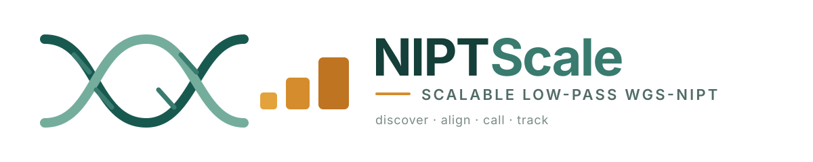
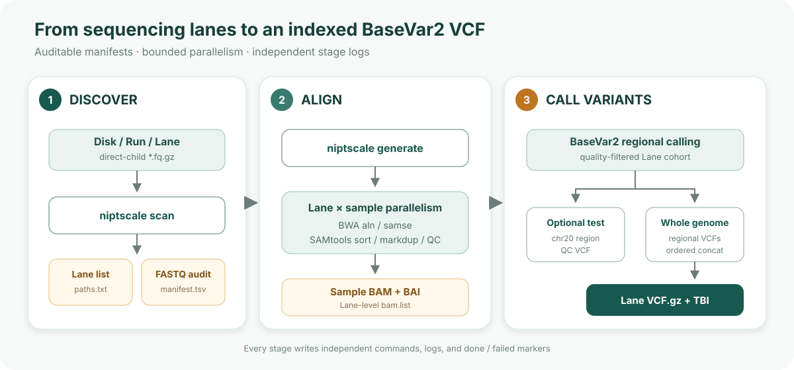

<p align="center">
  
</p>

<p align="center"><strong>A scalable workflow generator for single-end, low-pass WGS-NIPT cohorts</strong></p>

<p align="center">
  <a href="https://github.com/CKNckn11/NIPTScale/actions/workflows/tests.yml"></a>
  <a href="https://github.com/CKNckn11/NIPTScale/releases"></a>
  <a href="https://www.python.org/"></a>
  <a href="LICENSE"></a>
</p>

<p align="center"><strong>English</strong> | <a href="README_CN.md">简体中文</a></p>

NIPTScale discovers NIPT sequencing lanes, builds auditable FASTQ manifests, and generates independent shell jobs for alignment and [BaseVar2](https://github.com/ShujiaHuang/BaseVar2) variant calling. It is designed for population-scale maternal-plasma cfDNA produced as short, single-end, ultra-low-depth whole-genome sequencing (WGS-NIPT).

The architecture follows the useful separation used by [ilus](https://github.com/ShujiaHuang/ilus): Python validates inputs and generates jobs; bioinformatics tools run as transparent shell commands that can be inspected, submitted, stopped, and rerun independently.

> [!IMPORTANT]
> NIPTScale is a research workflow generator, not a clinical diagnostic system. Version 0.2.0 does not perform genotype imputation, association testing, fetal/maternal genotype separation, or clinical risk interpretation.

## Why NIPTScale?

- **NIPT-aware discovery** — scans a `Disk/Run/Lane/FASTQ` hierarchy without requiring a manually prepared sample sheet.
- **Auditable filtering** — records every included and excluded FASTQ, file size, and exclusion reason.
- **Two-level concurrency** — runs several lanes concurrently and several samples within each lane.
- **Single-end short-read alignment** — generates `bwa aln`/`bwa samse` jobs suitable for the current 35 bp dataset.
- **Separated stages** — alignment, optional regional testing, and whole-genome calling have independent commands, logs, outputs, and status markers.
- **Restartable execution** — valid BAMs are detected with `samtools quickcheck`; completed work can be reused.
- **BaseVar2 integration** — generates per-region calling jobs and concatenates them into an indexed lane-level VCF.
- **Scheduler-neutral outputs** — generated shell commands remain usable without the Python process and may be wrapped by a local or cluster scheduler.

## Workflow

<p align="center">
  
</p>

The regional test is recommended for validation but is not a software dependency of the WGS stage. Both calling stages require a completed `bam.list`.

## Scope and assumptions

| Item | Current support |
|---|---|
| Sequencing | Single-end, short-read, low-pass WGS-NIPT |
| Tested project pattern | 35 bp maternal-plasma cfDNA WGS-NIPT |
| Input unit | A lane directory named `L01`, `L02`, ... containing direct-child `*.fq.gz` files |
| Alignment | BWA `aln` + `samse`, followed by SAMtools processing |
| Variant calling | BaseVar2, split into genomic regions and concatenated per lane |
| Parallelism | Bounded lane-level and sample-level local concurrency |
| Output VCF | BaseVar2 lane-cohort VCF; not an imputed GWAS dosage VCF |
| Not implemented | Paired-end reads, SLURM backend, cross-lane cohort merge, imputation, GWAS, fetal genotype inference |

## Requirements

- Linux and Bash
- Python 3.9 or newer
- BWA 0.7.x
- SAMtools and BCFtools
- gzip
- [BaseVar2](https://github.com/ShujiaHuang/BaseVar2)
- GRCh38 FASTA with `.fai` and BWA index files
- A site-specific shell pipeline directory containing the scripts listed in [Configuration](docs/configuration.md)

NIPTScale itself has no mandatory third-party Python dependency. If PyYAML is available, full YAML syntax is supported; otherwise a small two-level YAML subset is used.

## Installation

```bash
git clone https://github.com/CKNckn11/NIPTScale.git
cd NIPTScale
python -m pip install -e .

niptscale --version
niptscale --help
```

The legacy command name `niptflow` is retained as a compatibility alias. New work should use `niptscale`.

## Quick start

### 1. Configure the deployment

Copy the generic template and replace the paths and resource limits:

```bash
cp examples/niptscale.example.yaml my.node.yaml
cp -r examples/site_pipeline /opt/niptscale-pipeline
# Edit /opt/niptscale-pipeline/00_config.sh before running real data.
```

```yaml
paths:
  scan_root: /data/NIPT
  result_root: /results/BaseVar2
  pipeline_dir: /opt/niptscale-pipeline

rules:
  min_fastq_bytes: 100000000
  lane_pattern: '^L\d{2}$'

parallel:
  alignment_lane_jobs: 4
  samples_per_lane: 8
  alignment_threads_per_sample: 3
  samtools_threads_per_sample: 2
  sort_memory_per_thread: 1G
  test_lane_jobs: 4
  wgs_lane_jobs: 4
```

`alignment_lane_jobs × samples_per_lane` is the maximum number of concurrently active sample alignments. CPU, memory, storage throughput, and the load on the shared filesystem must all be considered when setting these values.

### 2. Scan the data hierarchy

```bash
niptscale scan \
  -C my.node.yaml \
  -O /results/NIPTScale/path_manifest
```

The scan is read-only. It writes:

| File | Purpose |
|---|---|
| `nipt_lane_paths.txt` | One discovered lane path per line |
| `nipt_fastq_paths.txt` | All discovered FASTQ paths |
| `nipt_lane_summary.tsv` | Total, included, and excluded FASTQs per lane |
| `nipt_fastq_manifest.tsv` | Sample path, size, status, and exclusion reason |

By default, FASTQs smaller than 100,000,000 bytes and names containing `undecoded` are excluded from analysis but retained in the inventory.

### 3. Generate independent jobs

For all lanes in the scan manifest:

```bash
PROJECT=/results/NIPTScale/projects/example

niptscale generate \
  -C my.node.yaml \
  -I /results/NIPTScale/path_manifest/nipt_lane_paths.txt \
  -O "${PROJECT}"
```

For selected lanes only:

```bash
niptscale generate \
  -C my.node.yaml \
  -L /data/NIPT/Disk10/V350298010/L01 \
  -L /data/NIPT/Disk10/V350298010/L02 \
  -O "${PROJECT}"
```

### 4. Run the stages

```bash
# FASTQ -> per-sample BAM/BAI -> lane bam.list
nohup bash "${PROJECT}/00.shell/01.alignment.commands.sh" \
  > "${PROJECT}/00.shell/alignment.master.log" 2>&1 < /dev/null &
echo $! > "${PROJECT}/00.shell/alignment.pid"

# Optional regional BaseVar2 validation
nohup bash "${PROJECT}/00.shell/02.test.commands.sh" \
  > "${PROJECT}/00.shell/test.master.log" 2>&1 < /dev/null &

# Whole-genome BaseVar2 calling
nohup bash "${PROJECT}/00.shell/03.wgs.commands.sh" \
  > "${PROJECT}/00.shell/wgs.master.log" 2>&1 < /dev/null &
```

Do not start `02.test` or `03.wgs` until alignment has completed and the lane `bam.list` exists.

### 5. Check status

```bash
niptscale check-jobs \
  -P "${PROJECT}" \
  -O "${PROJECT}/job_status.tsv"
```

States are `done`, `failed`, or `pending_or_running`. See [Output layout](docs/output-layout.md) for the complete directory structure and expected VCF location.

## Commands

```text
niptscale scan          Discover lanes and build FASTQ inventories
niptscale generate      Generate alignment, test, and WGS jobs
niptscale run-commands  Execute a command list with bounded concurrency
niptscale split-jobs    Split a command file into smaller independent jobs
niptscale check-jobs    Summarize .done/.failed job markers
```

Detailed documentation:

- [Configuration reference](docs/configuration.md)
- [Architecture and execution model](docs/architecture.md)
- [Output layout and result interpretation](docs/output-layout.md)

## BaseVar2 VCF and downstream GWAS

NIPTScale produces an indexed BaseVar2 VCF for each lane cohort. That VCF contains called or probabilistic genotype information emitted by the installed BaseVar2 version. It is a **variant-calling result**, not automatically a well-imputed GWAS dosage dataset.

Before association testing, a cohort normally still needs sample identity checks, harmonized reference alleles/build, variant and sample QC, cross-lane integration, population structure assessment, and a low-pass-compatible genotype imputation strategy. Maternal-plasma cfDNA also requires a study-specific justification for treating the inferred signal as maternal genotype. NIPTScale 0.2.0 intentionally leaves these study-design decisions outside the workflow.

## Relationship to BaseVar2 and ilus

- [BaseVar2](https://github.com/ShujiaHuang/BaseVar2) is the external variant caller. NIPTScale does not reimplement or redistribute its algorithm.
- [ilus](https://github.com/ShujiaHuang/ilus) inspired the configuration-driven, independent-script workflow pattern. NIPTScale is not a fork of ilus and focuses on the project-specific NIPT hierarchy, single-end short reads, FASTQ inventory, and BaseVar2 orchestration.

## Testing

```bash
python -m unittest discover -s tests -v
```

The test suite checks FASTQ discovery/filtering, manifest generation, configuration parsing, command execution, job splitting, and status collection. It does not replace an end-to-end validation with real BWA, SAMtools, reference files, and BaseVar2.

## Citation

If this software contributes to published work, cite the repository/version and the BaseVar2 method used for variant calling:

> Liu S. et al. Utilizing non-invasive prenatal test sequencing data for human genetic investigation. *Cell Genomics* 4, 100669 (2024). https://doi.org/10.1016/j.xgen.2024.100669

Repository citation metadata are provided in [`CITATION.cff`](CITATION.cff).

## Data governance

NIPT data are sensitive maternal and fetal genomic data. Keep raw FASTQs, BAMs, VCFs, manifests, and phenotype links in access-controlled storage; minimize identifiers in filenames and logs; and follow the applicable consent, ethics, and data-transfer requirements. Do not upload individual-level genomic data to this repository.

## License

NIPTScale is released under the [MIT License](LICENSE). BaseVar2 and other external tools retain their own licenses.
